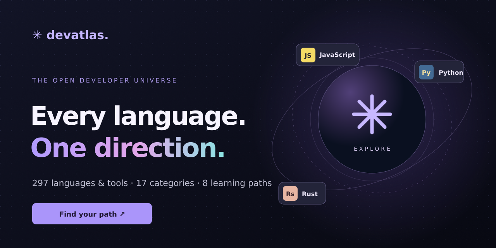

# ✳ DevAtlas



**Every language. One direction.**

DevAtlas is a free, accessible developer-discovery platform for finding languages, frameworks, runtimes, and tools that fit what you want to build.

**Live platform:** [devatlas-samer-2026.usefulotter1.chatgpt.site](https://devatlas-samer-2026.usefulotter1.chatgpt.site/)

## What you can do

- Explore **297 unique technologies** across **17 categories**, from modern web stacks to embedded systems and legacy enterprise languages.
- Browse **all 159 distinct entries** in the original 15 requested categories through a dedicated language map.
- View and copy **157 native source examples** from technology profiles; the same examples are committed as source files in this repository. Scratch and LabVIEW G are represented as visual programming environments.
- Search and filter the entire catalog with keyboard support (press `/` to search).
- Compare up to three technologies by use case, category, and available learning guidance.
- Save technologies into a personal shortlist (stored only in your browser).
- Generate one of eight goal-based starter learning paths, then copy it.
- Get and share a practical build-in-public coding challenge.

### What's included?

The complete original brief covers front-end, back-end, mobile, AI, systems, databases, games, DevOps, science, blockchain, enterprise, functional, hardware, markup, and other programming languages. The catalog also adds emerging and specialized languages (e.g., Gleam, Mojo, Odin, WGSL, Q#) and major developer ecosystems (React, Angular, Vue, Next.js, Flutter, Node.js, Docker, Kubernetes, and more).

See [LANGUAGE_COVERAGE.md](LANGUAGE_COVERAGE.md) for every original entry and its source-example status. In the live app, open **Language map** to see all 15 categories at once. Select a language and, where available, copy its educational example or open the matching native source file on GitHub.

**Why GitHub may say “JavaScript 100%”:** The Languages panel measures the bytes of recognized source-code files, **not** the number of technologies that a website catalogs or supports. The first version was primarily written in JavaScript. This update adds native examples in many languages, but GitHub's automatic statistics still will not list every entry (React is a library; Scratch and LabVIEW G are visual environments; markup and queries are different artifact types). We do not artificially re-label code to manipulate those statistics.

**Important:** React and Angular are frameworks rather than programming languages; JSON and HTML are data/markup formats. They're intentionally searchable alongside languages, with their type differentiated. DevAtlas is a curated reference and pathway tool, **not** a runtime/compiler for all 297 technologies.

## Tech stack

The website is deliberately lightweight, with no application dependencies:

- HTML5 and semantic UI
- Modern CSS with responsive layouts
- Vanilla JavaScript modules
- LocalStorage for shortlists
- Static deployment

This keeps the platform fast to load, easy to host, and straightforward for newcomers to contribute to. The **catalog covers** the full language universe; using all languages to build one frontend would make it harder to maintain and offer no user benefit.

## Run locally

Serve the `dist` directory using a static server, for example:

```bash
python3 -m http.server 8080 --directory dist
```

Then open `http://localhost:8080`. ES module imports may not run correctly from `file://`.

## Test

```bash
npm run build:examples
npm test
```

The build step regenerates the example folders, site-copy assets and coverage matrix from `examples/specs.mjs`. Tests check catalog consistency, path references and source examples.

## Help grow the atlas

Want to add a language, improve its references, or suggest a learning path? Open an issue or pull request. See [CONTRIBUTING.md](CONTRIBUTING.md).

## Scope and transparency

- Counts represent **unique catalog entries**, not programming languages exclusively.
- Descriptions and learning profiles are directional editorial guidance, not quantitative benchmarks, job-market facts, or personalized employment advice.
- Featured entries link to official documentation where available.
- Shortlists stay in the browser; there are no accounts or analytics trackers.

---

Designed and developed by **[Samer Tallauze](https://samertall.com)** · [GitHub](https://github.com/samertall) · [LinkedIn](https://linkedin.com/in/samertallauze)

MIT License.
